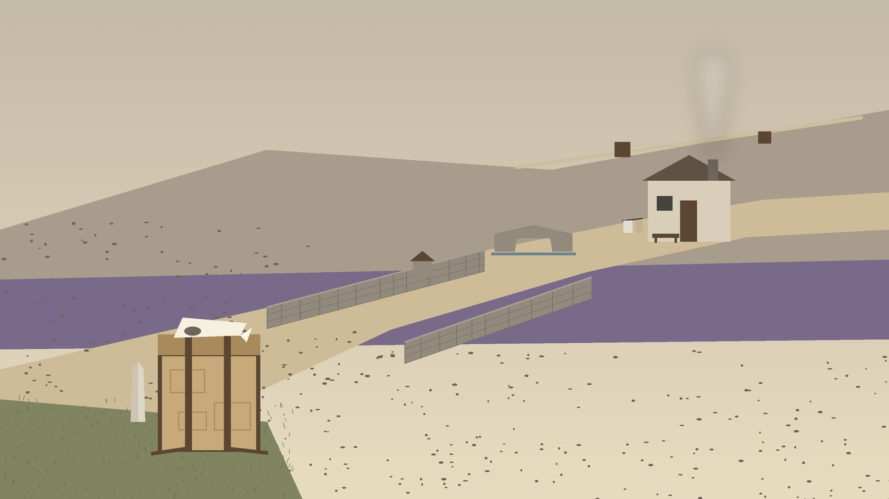
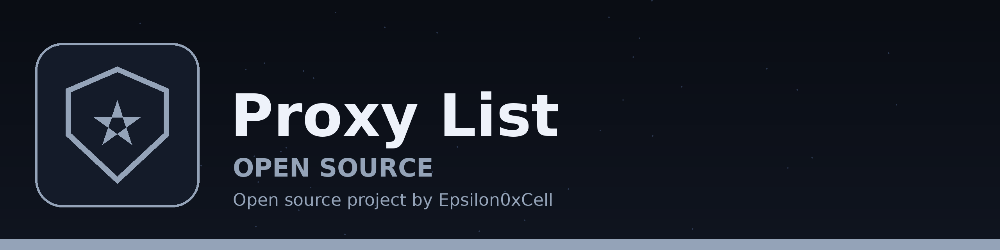
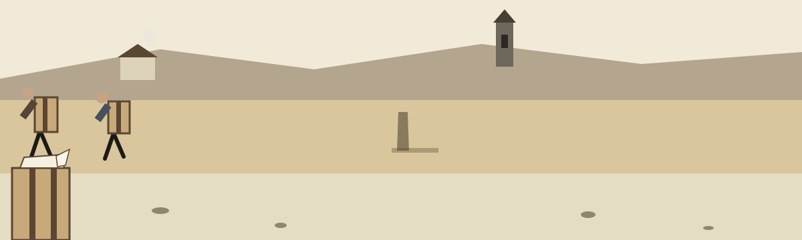
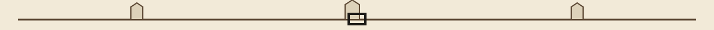
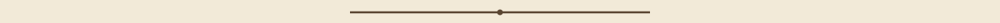

# Proxy-List

> **Pinned notice, the warning at the gate.**
>
> SECURITY ADVISORY WARNING: DO NOT TRUST ANY PROXIES IN THIS LIST, THIS IS A FORK OF THE PROXY-LIST PROJECT FOR SECURITY ANALYSIS PURPOSES, PROFESSIONAL-USE ONLY.
>
> IF YOU USE THIS KNOW WHAT YOU ARE DOING.

Why I keep that warning at the top: I did not write these lists, and I do not check the entries one by one. The addresses in http.txt, socks4.txt, and socks5.txt came from the upstream project this repo forks. I keep this copy so I can study proxy data for security analysis. Keeping a copy here is not me saying any single entry in it is safe to send traffic through.

> **Pinned notice, provenance.** The entries in the three files came unchecked from the upstream project this repository forks. Keeping a copy here is not a claim that any single entry is safe to send traffic through.

The auto-update workflow that used to run here was removed on 2026-10-31. It ran a script fetched from a secret-held address, in the job that commits and pushes, with the code nowhere in this repo, so nobody reading this repo could check what was actually running.
